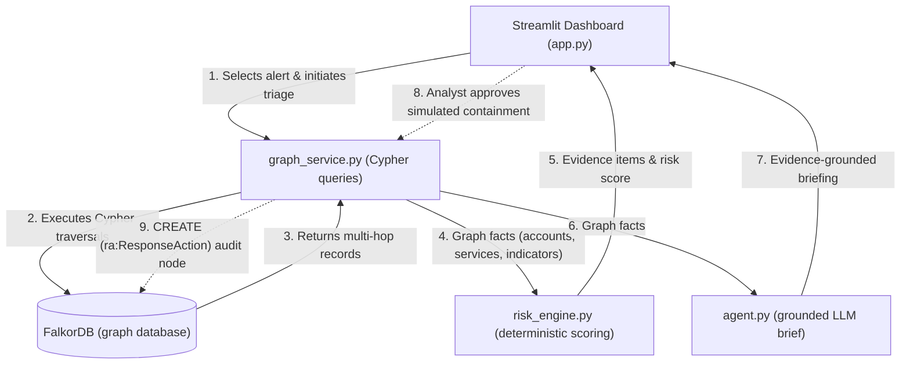

# GraphSentry

An explainable, graph-native security investigation agent powered by FalkorDB.

**Hackathon Track:** Track 01 — Agents That Act on Connected Data  
**Demonstration Safety:** All data records and alerts are synthetic. Network addresses use RFC 5737 documentation ranges (`203.0.113.77`, `192.0.2.55`). Response actions are simulated database entries; GraphSentry does not connect to or alter live production systems.

---

## Project Overview

Modern Security Operations Centers (SOCs) face alert fatigue: individual security events are flagged in isolation without the broader context of who owns the account, what permissions they hold, what infrastructure they can access, or whether other accounts share the same suspicious activity.

**GraphSentry** transforms disconnected security alerts into contextual, multi-hop investigations. Using **FalkorDB** as its primary graph database, GraphSentry traces connections between alerts, source IP addresses, user identities, client devices, IAM roles, cloud projects, application services, service dependencies, and threat indicators.

### Who Benefits?
- **SOC Analysts & Incident Responders:** Rapidly evaluate true blast radius and cross-account attacks without manual log correlation across separate tools.
- **Security Engineers:** Understand systemic exposure by traversing identity-to-service permissions and downstream dependency trees.

### What Makes FalkorDB Essential?
FalkorDB is not a visualization layer added onto an external relational database. It is the core operational source of truth:
1. **Multi-Hop Traversal:** Follows paths from `(Alert)` → `(Account)` → `(Role)` → `(Project)` → `(Service)` → `(Dependency)`.
2. **Entity Correlation:** Detects cross-account compromise by querying `(IP)-[:SEEN_WITH]->(Account)` relationships.
3. **Indicator Matching:** Evaluates whether active threat intelligence indicators link directly to observed events.
4. **Persistent Action Audit:** When an analyst records a simulated response, GraphSentry writes a `ResponseAction` node with `HAS_RESPONSE_ACTION` and `TARGETS_ACCOUNT` relationships directly into FalkorDB.

Removing FalkorDB eliminates the evidence retrieval, correlation, blast radius mapping, and persistent action log that power the investigation.

### Prototype Status: Live vs. Simulated
- **Live & Operational:** Real-time FalkorDB graph connection, multi-hop Cypher queries, deterministic evidence scoring, Graphviz attack graph rendering, optional Groq LLM summary with deterministic fallback, and graph write-backs for response actions.
- **Synthetic & Simulated:** Security events are synthetic scenarios; containment actions write audit records to FalkorDB for demonstration and do not lock real identity providers or isolate physical devices.

---

## Problem & Solution

| Traditional Alert Triage | GraphSentry Investigation |
|---|---|
| Single alert viewed in isolation (e.g., "login from unfamiliar IP"). | Multi-hop traversal links IP to account, device trust, roles, and reachable cloud projects. |
| Blast radius unknown without cross-checking asset databases. | Graph reveals direct services and transitive downstream dependencies (`Payments API` → `Customer DB`). |
| Multi-account sweeps missed across disparate logs. | FalkorDB correlates source IP with all accounts seen from that address (`SEEN_WITH`). |
| Risk score from opaque machine learning models. | Transparent, deterministic score where every point cites a verified graph fact. |
| Containment actions logged in external ticketing systems. | Response action nodes written directly into the graph to maintain an auditable timeline. |

---

## Key Features

- **Multi-Hop Context Retrieval:** Runs live Cypher queries against FalkorDB to discover connected identities, hardware devices, and permissions.
- **Service Dependency & Blast Radius Mapping:** Automatically traverses project hosting and service-to-service dependency chains (`[:DEPENDS_ON*1..3]`).
- **Cross-Account Correlation:** Identifies when multiple user accounts share the same source infrastructure.
- **Threat Indicator Correlation:** Queries direct relationships to threat indicators (`MATCHES_INDICATOR`, `OBSERVED_ON`) and scores them based on verified severity or confidence.
- **Explainable Scoring Engine:** Calculates risk using a transparent 6-rule engine capped at 100 points.
- **Grounded AI Briefing:** Formulates an analyst summary using Groq LLM constrained strictly to retrieved graph facts, with an automatic deterministic fallback if no API key is provided.
- **Auditable Action Persistence:** Approving a simulated containment writes a persistent `ResponseAction` node back to FalkorDB.

---

## Architecture



---

## How the Graph Investigation Works

When an analyst selects an alert and clicks **Investigate with graph context**, GraphSentry executes five targeted Cypher traversals in FalkorDB:

1. **Primary Context:** Traces `(Alert)` to its source `(IP)`, target `(Account)`, associated `(Device)`, and assigned `(Role)` nodes.
2. **Shared Accounts Correlation:** Finds all other accounts associated with the source IP via `(IP)-[:SEEN_WITH]->(Account)`.
3. **Reachable Services:** Follows permissions from `(Account)-[:CAN_ACCESS]->(Project)-[:HOSTS]->(Service)`.
4. **Transitive Dependencies:** Traverses downstream dependencies from hosted services using `(Service)-[:DEPENDS_ON*1..3]->(Service)`.
5. **Matched Threat Indicators:** Matches threat intelligence indicators linked to the alert via `[r:MATCHES_INDICATOR|OBSERVED_ON]->(Indicator)`.

---

## Risk Scoring

The risk engine (`risk_engine.py`) is deterministic, transparent, and grounded strictly in facts retrieved from FalkorDB.

### Implemented Scoring Rules

| Condition | Points | Evidence Detail |
|---|:---:|---|
| **Known-Bad Source IP** | +25 | Source IP reputation is marked `known-bad` or `malicious` in FalkorDB. |
| **Elevated Privilege** | +25 | Target account has privilege tier `admin`, `administrator`, or `elevated`. |
| **Untrusted Device** | +15 | Associated device trust status is `untrusted`, `unknown`, or `compromised`. |
| **Multi-Account Correlation** | +20 | Source IP is connected to 3 or more distinct accounts in the graph. |
| **Critical Service Reach** | +15 | Traversal reaches a service or dependency with `critical` or `high` criticality. |
| **Threat Indicator Match** | +15 | Alert links to an indicator with `high`/`critical` confidence or severity. Excludes indicators marked `low`, `info`, `informational`, `benign`, or `clean`. |

- **Score Cap:** Total score is capped at `100` (`min(score, 100)`).
- **Risk Bands:**
  - `CRITICAL`: Score ≥ 75
  - `HIGH`: Score ≥ 50
  - `MEDIUM`: Score ≥ 25
  - `LOW`: Score < 25

> **Heuristic Note:** These scoring weights and thresholds are demonstration heuristics designed to illustrate explainable, graph-backed triage. They do not constitute an industry-certified risk assessment framework.


---

## Prerequisites & Setup

### Prerequisites
- Windows, macOS, or Linux
- **Docker Desktop** (with Docker engine running)
- **Python 3.10+** (Python 3.11 or 3.13 recommended)

### 1. Clone the Repository
```bash
git clone <YOUR_REPOSITORY_URL>
cd graphsentry_hackathon
```

### 2. Start FalkorDB
Launch the official FalkorDB container using the provided Compose configuration:
```powershell
docker compose up -d falkordb
docker compose ps
```
FalkorDB will be available on `localhost:6379`.

### 3. Create and Activate Virtual Environment

**Windows (PowerShell):**
```powershell
py -m venv .venv
.\.venv\Scripts\Activate.ps1
```
*Note on PowerShell Execution Policy:* If script execution is blocked (`PSSecurityException`), run `Set-ExecutionPolicy -Scope Process -ExecutionPolicy Bypass` in your terminal session, or invoke the venv binary directly:
```powershell
.\.venv\Scripts\python.exe -m pip install -r requirements.txt
.\.venv\Scripts\python.exe -m streamlit run app.py
```

**macOS / Linux:**
```bash
python3 -m venv .venv
source .venv/bin/activate
```

### 4. Install Dependencies
```bash
python -m pip install --upgrade pip
pip install -r requirements.txt
```

### 5. Configure Environment Variables
Copy the example environment configuration:
```powershell
# Windows PowerShell
Copy-Item .env.example .env

# macOS / Linux
cp .env.example .env
```
Default connection values point to `localhost:6379` with graph name `graphsentry`. `GROQ_API_KEY` is optional; if omitted, GraphSentry uses the built-in deterministic briefing generator.

---

## Running the Application & Tests

### Start the Dashboard
```bash
streamlit run app.py
```
Open your browser at `http://localhost:8501`. If the database is empty, GraphSentry automatically seeds the synthetic demo graph on startup.

### Run Automated Tests
```powershell
.\.venv\Scripts\python.exe -m pytest tests/ -v
```

The test suite in `tests/test_risk.py` covers:
- High-impact alert evaluation (`AL-104` reaching 100 / CRITICAL).
- Low-privilege baseline scoring (`AL-309` scoring 0 / LOW).
- Score cap enforcement at 100 points maximum.
- Threat indicator filtering (excludes benign/low-severity, penalizes high/critical).
- Isolated node handling in graph inventory queries.
- Live FalkorDB integration test (runs against an isolated temporary graph when FalkorDB is online; safely skips when offline).

---

## Graph Model & Cypher Reference

### Node Schema

| Label | Identifying Property | Additional Properties | Purpose |
|---|---|---|---|
| `Alert` | `id` | `title`, `description`, `event_time`, `source` | Security event under investigation |
| `IP` | `address` | `reputation`, `first_seen`, `data_origin` | Network address; correlation anchor |
| `Account` | `username` | `privilege`, `department`, `status` | Targeted identity and permission holder |
| `Device` | `device_id` | `trust`, `managed` | Endpoint hardware and posture status |
| `Role` | `name` | `risk_tier` | IAM role defining access levels |
| `Project` | `name` | `environment`, `owner` | Cloud workspace hosting workloads |
| `Service` | `name` | `criticality`, `kind` | Application service, database, or worker |
| `Indicator` | `value` | `indicator_type`, `confidence`, `severity`, `description` | Threat intelligence IoC indicator |
| `ResponseAction` | `id` | `kind`, `status`, `target`, `rationale`, `created_at` | Audit trail record for response actions |

### Relationship Schema

| Relationship | Pattern | Semantics |
|---|---|---|
| `ORIGINATED_FROM` | `(Alert)->(IP)` | Alert originated from network address |
| `TARGETS` | `(Alert)->(Account)` | Alert targeted user account |
| `OBSERVED_ON` | `(Alert)->(Device)` or `(Alert)->(Indicator)` | Alert observed on device or matches indicator |
| `MATCHES_INDICATOR` | `(Alert)->(Indicator)` | Alert correlates with threat indicator |
| `USED_DEVICE` | `(Account)->(Device)` | Account logged in using device |
| `HAS_ROLE` | `(Account)->(Role)` | Account assigned IAM role |
| `CAN_ACCESS` | `(Account)->(Project)` | Account has permission to access project |
| `HOSTS` | `(Project)->(Service)` | Project hosts workload or service |
| `DEPENDS_ON` | `(Service)->(Service)` | Service has upstream runtime dependency |
| `SEEN_WITH` | `(IP)->(Account)` | IP address observed with account |
| `HAS_RESPONSE_ACTION` | `(Alert)->(ResponseAction)` | Alert response action recorded |
| `TARGETS_ACCOUNT` | `(ResponseAction)->(Account)` | Response action targets account |

*All production queries and reference Cypher statements are documented in [cypher/queries.cypher](cypher/queries.cypher) and executed via [graph_service.py](graph_service.py).*

---

## AI Tool Disclosure

AI coding assistants (ChatGPT and Claude) were used during development to assist with initial project scoping, architecture planning, code scaffolding, and draft documentation.

All generated components were subsequently audited, tested, and verified:
- Designed, parameterized, and tested Cypher queries for multi-hop alert traversals and indicator correlation against FalkorDB.
- Implemented and tuned the deterministic risk engine (`assess_risk`) to ensure all risk points correspond to verified graph evidence.
- Built and styled the Streamlit dashboard, Graphviz attack graph visualization, and response action audit trail.
- Developed an automated test suite (16 tests) covering scoring rules, boundary conditions, isolated nodes, and live database integration.

---

## Limitations & Safety

- **Synthetic Data:** All alerts, IP addresses, accounts, and infrastructure entities are synthetic. IP addresses strictly utilize RFC 5737 documentation blocks (`203.0.113.0/24`, `192.0.2.0/24`).
- **Demonstration Heuristics:** The 6 risk scoring rules are heuristics designed to illustrate explainability and do not represent a production security compliance standard.
- **Simulated Containment:** Response actions create `ResponseAction` nodes in FalkorDB for audit demonstration; they do not isolate physical endpoints or disable production accounts.
- **Optional Groq LLM:** The Groq language model integration is purely for phrasing. Graph retrieval, evidence scoring, and response logging remain fully functional offline without an API key.
